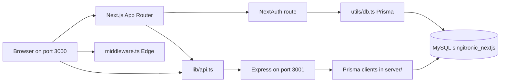

# Architecture

Written for Phase 0 on 21 October 2026. Each statement is marked **Verified in code**, **Inferred**, or **Needs SME**.

## Layers

| Piece | Where | Mark |
|-------|--------|------|
| Shop UI, App Router pages under `app/` | Next.js 15.5.3, React 18, port 3000 | Verified in code |
| Page guard for `/admin/:path*` only | `middleware.ts` | Verified in code |
| Sign-in | `app/api/auth/[...nextauth]/route.ts`, credentials provider, JWT, 15-minute `maxAge` | Verified in code |
| Browser and server-component calls to the API | `lib/api.ts` using `lib/config.ts` (`NEXT_PUBLIC_API_BASE_URL`, default `http://localhost:3001`). No `credentials` option. | Verified in code |
| HTTP API | `server/app.js`, Express 4, port 3001. Loads `server/.env`, then the root `.env`. | Verified in code |
| Database | MySQL database name `singitronic_nextjs` on port 3306 | Verified in code (URL). The server was not running during Phase 0. |
| Two Prisma schemas and two generated clients | Root 6.16.1 and `server/` 6.16.3. Migrations only under `prisma/migrations/`. | Verified in code |

`app/` holds routes (`page.tsx`, `layout.tsx`, route handlers under `app/api/`). `components/` holds UI, including `components/modules/wishlist/`. `lib/` holds the API client, config, and sanitizers. `server/` holds the Express app, `routes/`, `controllers/`, `middleware/`, `services/`, `scripts/`, and `utills/` (the double-l spelling is intentional). Zustand stores live in `app/_zustand/`.

A file under `app/` is a server component unless it starts with `"use client"`. `middleware.ts` runs on the Edge runtime. **Verified in code** for the files read in Phase 0 (`app/page.tsx` has no `"use client"`; `app/checkout/page.tsx` and `app/login/page.tsx` are client pages). **Needs SME** if a later story is unsure which new file should be which.

## How the front end reaches the API

1. `lib/config.ts` reads `NEXT_PUBLIC_API_BASE_URL` at build time. **Verified in code.**
2. `apiClient` prefixes that host and sets `Content-Type: application/json`. `post` and `put` run `JSON.stringify` on the body. **Verified in code.**
3. The spread order is `{ ...defaultOptions, ...options }`, so a caller can replace the headers object. **Verified in code.**
4. Three bulk-upload calls skip `apiClient` and use the literal `http://localhost:3001` (`app/(dashboard)/admin/bulk-upload/page.tsx`, `components/BulkUploadHistory.tsx`). **Verified in code.** Story XS-1.
5. Server components such as `components/ProductsSection.tsx` and `app/product/[productSlug]/page.tsx` call `apiClient` on the server. That `fetch` has no browser cookie. **Verified in code.** **Needs SME:** should those calls use the public URL or a separate internal URL? (Question already on XS-1.)

CORS in `server/app.js` allows `http://localhost:3000`, echoes credentials, and in development allows any `http://localhost:` origin. Requests with no `Origin` header are allowed. **Verified in code.**

## How sign-in works

1. `app/login/page.tsx` calls `signIn("credentials", { redirect: false, email, password })`. **Verified in code.**
2. `authorize` in the NextAuth route loads the user with the Next.js Prisma client (`utils/db.ts`) and checks the password with `bcryptjs`. On success it returns `id`, `email`, and `role`. **Verified in code.**
3. The `jwt` callback copies `id` and `role` onto the token and treats the token as expired after 15 minutes. Session strategy is `"jwt"`. **Verified in code.**
4. `middleware.ts` runs only for `/admin/:path*`. `authorized` requires a token whose `role` is `"admin"`. Anyone else is rejected by the middleware callback. The inner function also redirects non-admins to `/`. **Verified in code.**
5. The Express API never reads that token. `GET /api/orders` is mounted with no identity check. **Verified in code.** Story L-1.
6. Public registration is a separate Next.js route, `app/api/register/route.ts`, which also uses the Next.js Prisma client. **Verified in code** (file exists and RED_FLAGS RF10 names it). The body of that route was not re-read line by line in this pass. **Inferred** that it creates a `user` row the same way the handover describes.
7. The login screen still renders Google and GitHub buttons that call `signIn("google")` and `signIn("github")`. Those providers are commented out. **Verified in code.** **Needs SME:** remove the buttons, or configure the providers?

There is a second path to user records: the header calls `GET /api/users/email/<email>` from the browser to learn the user id. **Verified in code** in `components/Header.tsx`. That response is not what NextAuth uses for the admin check.

## Where authorisation is and is not enforced

| Surface | Enforced? | Mark |
|---------|-----------|------|
| `/admin/*` pages | Yes, JWT role must be `admin` | Verified in code |
| Storefront pages, `/login`, `/cart`, `/checkout` | No role check | Verified in code (`matcher` is only `/admin/:path*`) |
| Every Express route, including orders, users, products, bulk upload | No identity check | Verified in code (`server/app.js` mounts routers and no `server/routes/*.js` file was given an auth middleware; wishlist router is commented out) |
| Role stored on create/update user | Taken from the JSON body | Verified in code via RED_FLAGS RF2 and `server/controllers/users.js` being the file the story names. Not re-audited line by line beyond the handover. **Inferred** the line numbers still match. |

## Flow: placing an order

1. The shopper builds a cart in the Zustand store `app/_zustand/store.ts`. **Inferred** from the checkout page reading `products` and `total` the way the handover describes. The store file was not line-read in this pass.
2. `app/checkout/page.tsx` (client component) optionally looks up `GET /api/users/email/<email>` when a session exists, then posts `orderData` to `/api/orders` through `apiClient`. `orderData` includes the browser's `total`, address fields, and an optional `userId`. **Verified in code.**
3. `server/routes/customer_orders.js` sends `POST /` to `createCustomerOrder` in `server/controllers/customer_orders.js`. That controller constructs its own `PrismaClient`. **Verified in code.**
4. The page then loops and posts each line through `addOrderProduct` to `/api/order-product`. **Verified in code.** Route file: `server/routes/customer_order_product.js`. **Inferred** the handler writes `customer_order_product` rows. Story M-1 replaces this two-step write with one transaction.
5. Tax (`total / 5`) and shipping (`5`) are display-only. **Inferred** from RED_FLAGS RF3. Not re-derived from the JSX in this pass.

No payment step exists in this flow. **Inferred** from the story scope, which lists payment as out of scope.

## Flow: signing in and opening the admin area

1. `/login` submits credentials, as above. **Verified in code.**
2. NextAuth sets the session cookie. The cookie name was not logged in Phase 0. The handover names `next-auth.session-token`. **Inferred** until L-1 reads it.
3. The shop header (`HeaderTop`) links to `/login`, not to `/admin`. The Dashboard link in `components/Header.tsx` is rendered only when `pathname` already starts with `/admin`. The first admin visit is a direct request to `/admin`. **Verified in code.**
4. A request to `/admin` with no cookie returned HTTP 307 during the Phase 0 smoke test. **Verified** by request, and it matches `middleware.ts`.
5. Admin screens then call Express with `apiClient`, still without a cookie. **Verified in code** for `app/(dashboard)/admin/products/new/page.tsx`, which posts to `/api/products` and `/api/main-image`.

## Flow: an admin creates a product

1. The page `app/(dashboard)/admin/products/new/page.tsx` is under `/admin`, so the Edge middleware requires an admin JWT before the page loads. **Verified in code.**
2. The page loads merchants with `apiClient.get("/api/merchants")` and posts the product with `apiClient.post("/api/products", ...)`, then posts the main image to `/api/main-image`. **Verified in code.**
3. `server/app.js` mounts those paths on `server/routes/products.js`, `server/routes/merchant.js`, and `server/routes/mainImages.js`. None of those mounts add an auth middleware. **Verified in code.**
4. A second admin write path, bulk upload, does not use `apiClient`. It `fetch`es `http://localhost:3001/api/bulk-upload` with `FormData`. **Verified in code.** Story XS-1.

## Data notes that later stories depend on

- `Product` has `inStock`, `slug`, `id`, and `price` as `Int`. It has no SKU or colour column. The product page still passes `stock={94}` and prints SKU `abccd-18`. **Verified in code.** Story M-2.
- Wishlist router mount in `server/app.js` is commented out. `server/controllers/wishlist.js`, `app/wishlist/page.tsx`, `components/WishItem.tsx`, and `components/AddToWishlistBtn.tsx` are absent. `components/Header.tsx` returns before it uses the wishlist response. **Verified in code.** Story L-2.
- `server/app.js` exports the Express `app` and listens only when the file is the main module. That change was made in Phase 0 so tests can import it. **Verified in code.**
